  
  
  

## ⚡ CLASSIFIED FILE

## 🛡️ THE ARSENAL

## 🌌 MULTIVERSE OPERATIONS

<table>
<tr>
<td width="50%" valign="top">

### 💸 [ANSH-UPI](https://github.com/anshgandhi68-sys/ANSH-UPI)
Self-hosted UPI & COD payment gateway — zero platform fees, dynamic QR, WhatsApp OTP, auto verification.

`JavaScript` · `Payments` · `Self-hosted`

</td>
<td width="50%" valign="top">

### 🏢 [WORKIVO 2.0](https://github.com/anshgandhi68-sys/WORKIVO-2.0)
The next version of the Workivo platform — built by the founder himself.

`TypeScript` · `SaaS`

</td>
</tr>
<tr>
<td width="50%" valign="top">

### 🧠 [Strata](https://github.com/anshgandhi68-sys/Strata)
Run big LLMs on consumer hardware — one-click install, local OpenAI/Anthropic-compatible API.

`AI` · `Inference`

</td>
<td width="50%" valign="top">

### 🧪 [vibe-engineering](https://github.com/anshgandhi68-sys/vibe-engineering-ansh-)
38 engineering discipline skills for AI coding agents — quality gates, testing, deployment.

`AI Agents` · `Skills`

</td>
</tr>
<tr>
<td width="50%" valign="top">

### 🔩 [Goated](https://github.com/anshgandhi68-sys/Goated)
Agent skill for detailed isometric illustrations of real machines — polished SVGs, WebGL shaders.

`JavaScript` · `SVG` · `WebGL`

</td>
<td width="50%" valign="top">

### 🕵️ [Digital Detective](https://github.com/anshgandhi68-sys/digital-detective-8009-)
Investigation tooling from the hackathon front lines.

`Python`

</td>
</tr>
</table>

## 📡 POWER READINGS

## 🐍 THE DEVOURER OF COMMITS

<picture>
  <source media="(prefers-color-scheme: dark)" srcset="https://raw.githubusercontent.com/anshgandhi68-sys/anshgandhi68-sys/output/snake-dark.svg"/>
  
</picture>

